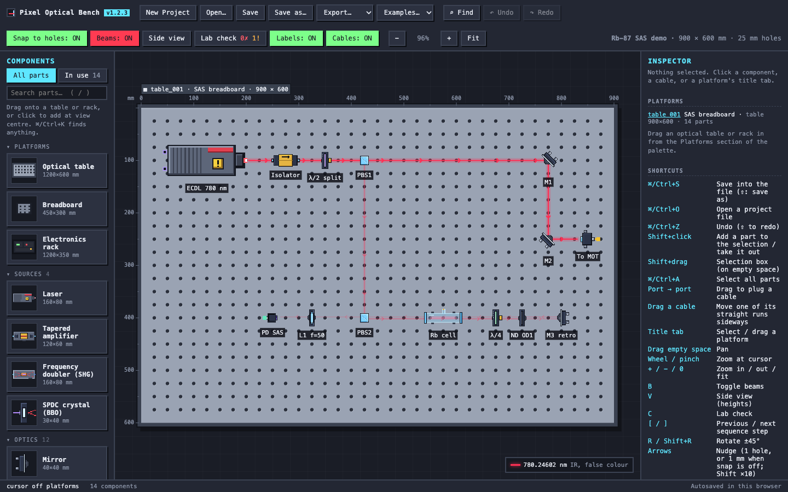
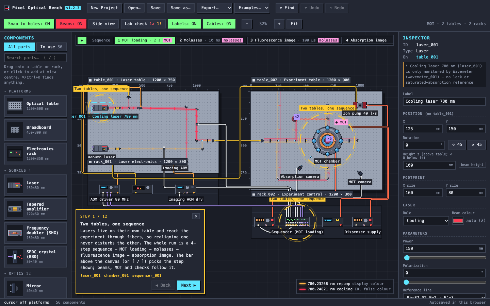
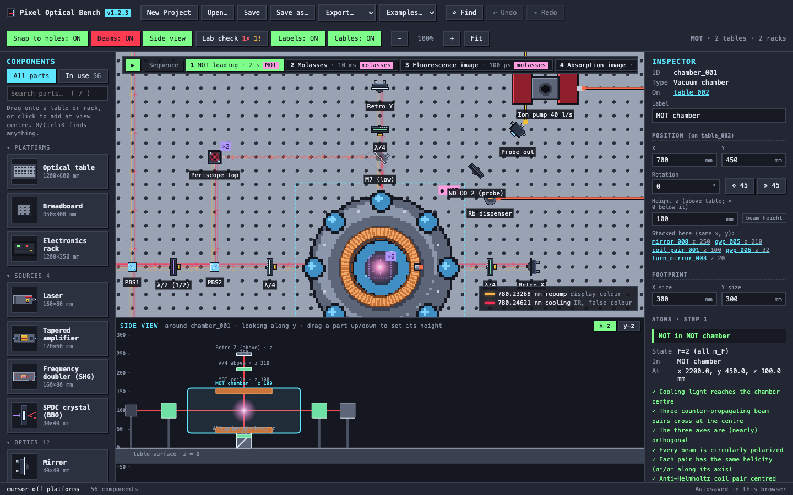
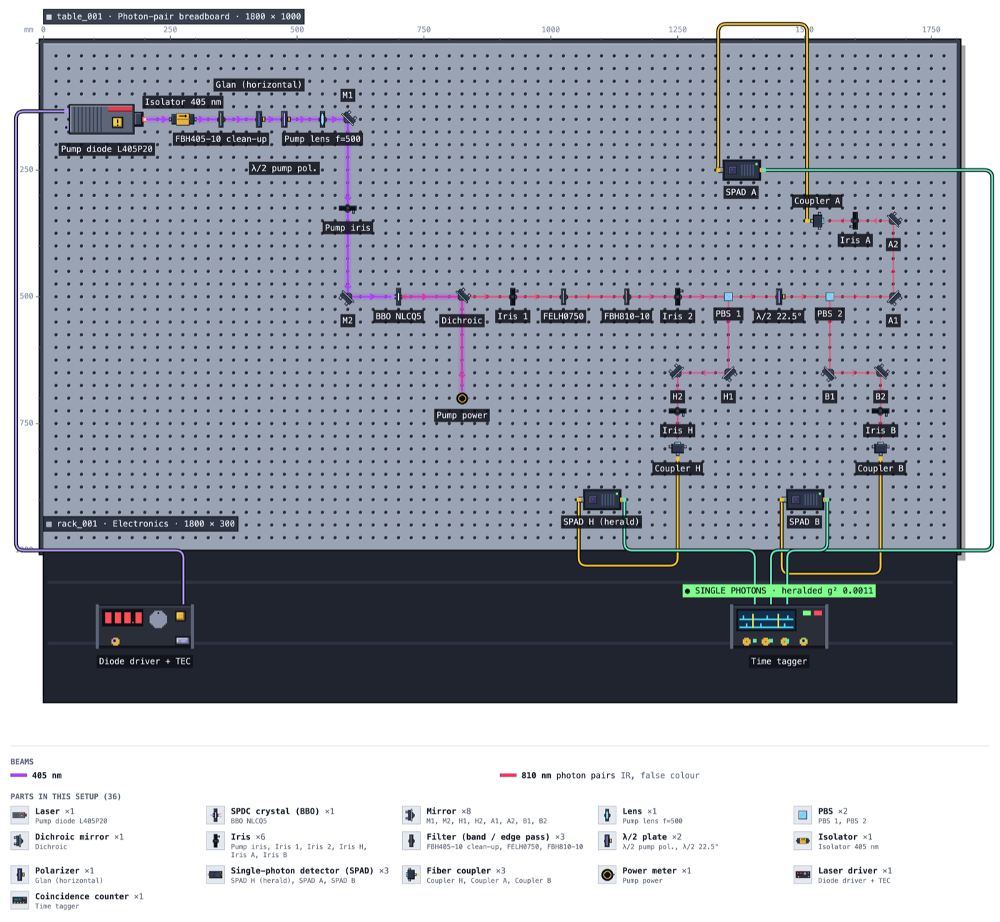
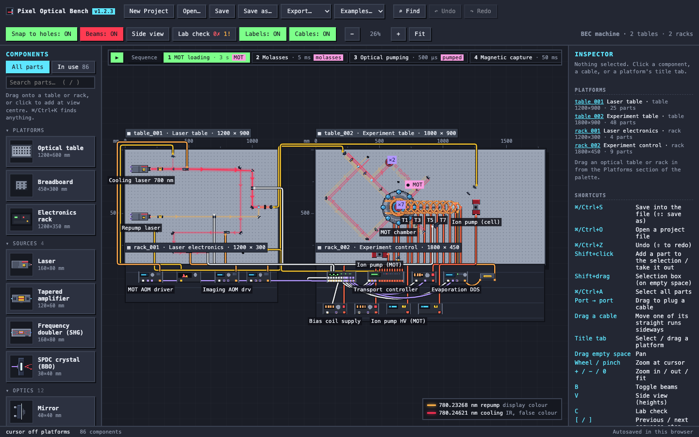

# Pixel Optical Bench

A pixel-art editor for optical tables, seen from above. Lay out the lasers, optics, vacuum
parts and electronics of an experiment on a table with real hole spacing, wire them up, and
see where every beam goes.

### ▶ Open it: https://balabalabalalaba.github.io/pixel-optical-bench/

It runs in the browser — nothing to install. Best in **Chrome or Edge** (there, *Save* writes
straight into your file).

## Start here
1. Open the link. On your first visit a welcome card offers four examples; any time later,
   pick one from **Examples…** in the toolbar, e.g. *MOT* or *Heralded single photons (HBT test)*.
2. Click **Start tour**: it walks you through the setup, part by part.
3. Or click **New Project**: set the table size and hole spacing, then drag parts from the
   left panel onto the table.

### Link straight to an example
Add `?example=` and an example's name to the address; `&tour=1` also starts its tour:
- https://balabalabalalaba.github.io/pixel-optical-bench/?example=rb87-sas — saturated absorption
- https://balabalabalalaba.github.io/pixel-optical-bench/?example=mot&tour=1 — the MOT, with its tour
- https://balabalabalalaba.github.io/pixel-optical-bench/?example=photon-heralded&tour=1 — heralded single photons

A link never replaces your own layout without asking. The names of all examples are listed
under *Examples inside* below.

## What it does
- **Parts**: lasers, mirrors, lenses, wave plates, polarizing beam splitters, AOMs and EOMs,
  fibers, vapor cells, cavities, vacuum chambers, coils, cameras, photodiodes, single-photon
  detectors, and rack electronics (laser drivers, PID controllers, function generators,
  oscilloscopes, a sequencer, …).
- **Beams** are traced through the optics automatically, with power and polarization. Hover
  over a beam to see where it comes from and where it goes. Every part has a height, and the
  **side view** (`V`) shows them.

  
- **Cables**: drag from one port to another to wire the electronics; fibers carry light from
  one table to another.
- **Experiment sequence**: steps with TTL and analog levels. ▶ plays them, and the table shows
  what is switched on in each step.
- **Checks**: laser locks, the MOT, photon-pair counts, and a **lab check** (`C`) that lists
  what is missing or wired wrongly. These are rule-based checks, not a physics simulation —
  check the numbers yourself.
- **Export**: a figure of the whole setup (PDF or PNG, with a legend), a parts list (CSV), or
  the project file.

  

## Saving your work
- Your layout is **saved automatically in this browser** (on this computer only).
- **Save as…** writes it into a `.optbench.json` file, **Open…** loads one. To share a setup
  with someone, send them the file.
- In Safari or Firefox, *Save* downloads a copy instead.

## Controls
| To | Do |
|---|---|
| Add a part | drag it from the left panel (or click it) |
| Move | drag it; with *Snap to holes* on, it lands on a hole |
| Select several | `Shift`+click, or `Shift`+drag a box |
| Rotate | `R` / `Shift+R` (±45°) |
| Nudge | arrow keys (`Shift` = ×10) |
| Pan / zoom | drag empty space · mouse wheel or pinch · `0` fits the view |
| Undo / redo | `⌘/Ctrl+Z` · `⌘/Ctrl+Shift+Z` |
| Duplicate / delete | `⌘/Ctrl+D` · `Delete` |
| Find anything | `⌘/Ctrl+K` |
| Show / hide beams, labels, cables | `B` · `L` · `W` |
| Side view · lab check | `V` · `C` |
| Sequence: previous / next step · play | `[` / `]` · `Space` |

With nothing selected, the right panel lists the shortcuts.

## Examples inside
Each opens from **Examples…** or from a link with `?example=` and its name.

| Example | Name for a link |
|---|---|
| Rb-87 saturated absorption spectroscopy | `rb87-sas` |
| PDH lock to a high-finesse cavity (578 nm) | `pdh-cavity` |
| MOT (two tables joined by a fiber) | `mot` |
| Rb laser locks (MTS, offset, intensity) | `rb-locks` |
| BEC machine (coil-chain transport, QUIC, evaporation) | `bec` |
| BEC machine (moving-coil track) | `bec-track` |
| BEC machine (crossed dipole trap, Feshbach) | `bec-dipole` |
| Rydberg EIT microwave electrometer | `rydberg` |
| Rydberg atom array in optical tweezers, after Ebadi et al., *Nature* 595, 227 (2021) | `rydberg-array` |
| Strontium optical lattice clock, after the PTB 87Sr clock (Falke et al.) | `sr-clock` |
| Ytterbium optical lattice clock, after the INRIM 171Yb clock (Pizzocaro et al.) | `yb-clock` |
| Atom gravimeter (Raman interferometer), after the LNE-SYRTE Cold Atom Gravimeter (Farah et al.) | `atom-gravimeter` |
| Photon pairs (SPDC, two single-photon detectors), after Trojek et al., *Opt. Express* 12, 276 (2004) | `photon-pairs` |
| Photon pairs: measuring g² (alignment walk-through) | `photon-g2` |
| Photon pairs: collinear, split by a PBS | `photon-collinear` |
| Heralded single photons (HBT test) | `photon-heralded` |
| Heralded single photons at 3° (HBT test) | `photon-heralded-3deg` |

---
Questions or ideas? Open an issue on [this repository](https://github.com/balabalabalalaba/pixel-optical-bench/issues),
or find me at https://balabalabalalaba.github.io/.

Pixel Optical Bench is free to use, copy and change under the [MIT licence](LICENSE). It is
built with open-source libraries (React, Konva, react-konva, zustand and their helpers, all
MIT-licensed); their licences are in [THIRD-PARTY-NOTICES.txt](THIRD-PARTY-NOTICES.txt).

Version 1.3.0 · updated 2026-11-14
